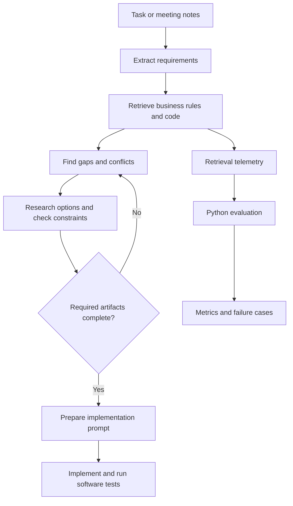

# Gated Planning Framework

**A workflow that helps AI coding agents understand a change before they implement it.**

Coding agents can produce plausible code while missing a business rule, an existing implementation, a database constraint, or a project convention. Gated Planning Framework makes those dependencies explicit: it gathers evidence, checks for gaps and conflicting decisions, and asks for required planning artifacts before the workflow moves to implementation.

It is a portfolio prototype built around **Claude Code**, a project-context **MCP server**, shell-based workflow checks, and a **Python retrieval-evaluation** package.

## How it works



The gates check that required steps and artifacts are present; they **do not guarantee that an AI decision is correct**. Human review and ordinary software tests are still necessary.

## Main components

- **`.claude/`** — agent instructions and shell checks for requirement extraction, gap analysis, solution review, and planning gates.
- **`dev-context-mcp/`** — MCP tools for searching project code and business rules, inspecting Symfony routes and Doctrine entities, scanning project structure, and recording retrieval telemetry.
- **`retrieval-eval/`** — Python CLI and FastAPI endpoints for building a retrieval test set, comparing keyword and BM25 search, and inspecting metrics and missed results.
- **`examples/sample-run/`** — illustrative artifacts showing what a workflow run can produce.

## Quick start

1. Install Node.js 20+, Python 3.10+, `ripgrep` (`rg`), and Claude Code. PHP/Composer are optional for route introspection.
2. Update `framework.config.json` for the codebase you want to inspect. Replace the included fictional business rules with verified rules from that project.
3. Start the MCP server:

   ```bash
   cd dev-context-mcp
   npm install
   npm start
   ```

4. Run the Python checks and inspect the evaluation CLI:

   ```bash
   cd retrieval-eval
   python -m venv .venv
   source .venv/bin/activate
   pip install -r requirements.txt
   PYTHONPATH=src python -m pytest -q
   PYTHONPATH=src python -m retrieval_eval.cli --help
   ```

See **[Development and evaluation](docs/DEVELOPMENT.md)** for configuration, API usage, repository checks, and evaluation commands.

## Evaluation

The Python package reports ranking metrics including Success@k, MRR, and nDCG, and records retrieval failures. Its current comparison is between keyword search and BM25. Automatically generated queries can be easier than realistic developer questions, so credible quality claims require a manually reviewed test set and a controlled comparison.

**No measured performance improvement is claimed.** The repository is a prototype, not a production-ready platform. Retrieval and source scanning have limitations, and the included business-domain content is fictional sample data. Review the configuration and examples before using or publishing them.

## License

No license is currently included. Add one before permitting reuse or redistribution.
